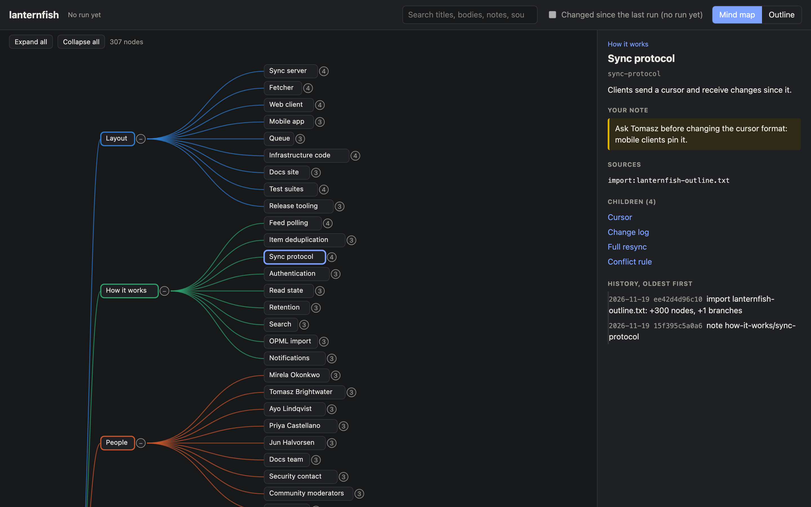
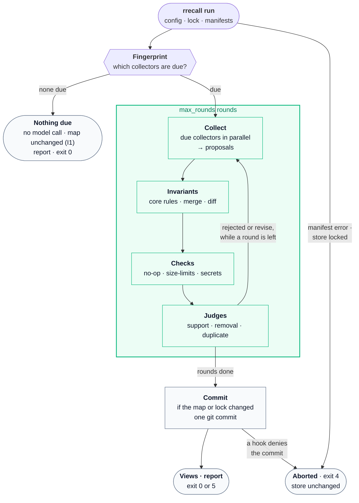

<p align="center">
  
</p>

<h3 align="center">A versioned map of a software project, built from its own sources, for coding agents and people</h3>

<p align="center">
  
  
  
  
  
  
</p>

<p align="center">
  <a href="#-recent-updates"><b>Recent updates</b></a> ·
  <a href="#-key-features"><b>Key features</b></a> ·
  <a href="#-quick-start"><b>Quick start</b></a> ·
  <a href="#-how-it-works"><b>How it works</b></a> ·
  <a href="docs/plugins.md"><b>Plugin guide</b></a> ·
  <a href="docs/SPEC.md"><b>Spec</b></a> ·
  <a href="#-read-next"><b>Read next</b></a>
</p>

<br>

`rrecall` keeps a map of a software project: what lives where, how it works, who owns what, what
was done, what is blocked and why decisions were made. A run sends **collectors** over the
project's sources (the repo, its git history, GitHub, Slack, your own plugins), and **checks and
judges** accept or reject each change they propose, sending rejections back for rework before
anything is committed. The map lives in **its own git repository**, so every change shows in
`git diff` and `git blame`. It is **stable**: a run with no collector due calls no model and
leaves the map byte for byte as it was (invariant **I1**), and no run removes a node without evidence.
Coding agents query it from the command line, one node or branch with `rrecall show`; people read
it as an HTML page.

<p align="center">
  
  <br>
  <sub><code>rrecall open</code> on the map of an invented project: the mind map, and one node with its note, sources, children and history.</sub>
</p>

## 📣 Recent updates

### 🔥 2026.11.19: rrecall 0.1.0, the first release
- **A map that stays put**: rrecall builds the map from a project's repository, its GitHub issues
  and its Slack, and keeps it in its own git repository on your machine. A run with no collector
  due calls no model and leaves the map as it was; a run removes a node only with evidence that it is no
  longer true (`rrecall rm` removes one by hand).
- **Answers for agents and people**: `rrecall ls` lists the tree, `show` prints one node or branch
  with its subtree, `find`, `why` and `recent` search the map and its history, in compact Markdown
  or JSON; `rrecall agent-instructions` prints the paragraph
  for an agent's instruction file, and `rrecall open` renders the HTML view.
- **Collectors, checks and judges on Claude Code or Codex**: four built-in collectors, three
  checks and three judges; a rejected change goes back to its collector for at most `max_rounds`
  rounds (two by default), and what is still rejected stays out of the commit and in the run report.
- **Runs that read only what changed**: by default, where a collector supports it; `--force`
  reads afresh within each collector's limits and reports drift. On a real project, the second of
  two forced runs changed 5 of 131 nodes (3.8%), within the 5% bound.
- **Your own sources and judges**: a plugin is a manifest and a prompt, or a program in any
  language that reads and writes JSON; `rrecall plugin add` installs one and `rrecall doctor`
  checks that each can run.
- **Upgrade note**: the first release, nothing to migrate. Built and tested on macOS and Linux;
  the live acceptance run used the `claude` runner (collectors on Opus 5.5, judges on Sonnet 5.5).
  [Release notes](https://github.com/decadance-dance/rrecall/releases/tag/0.1.0)

## 🚀 Key features

### 🗺️ A map that stays put
> *Every run that changes the map or its lock is one git commit; a run with no collector due calls no model and leaves the map as it was.*

* **Its own git repository**: one JSONL file per branch, one node per line, sorted by id, so an
  unchanged node keeps a byte-identical line and `git blame` names the run that last changed it.
  The store stays on your machine: it has no remote, and rrecall never adds one.
* **Nothing due, nothing spent** (I1): each collector has a cheap fingerprint (a commit, the
  newest `updatedAt`, a hash) or a `min_interval`; when none is due, the run calls no model and
  leaves the map as it was, and commits at most a lock change (a collector whose fingerprint
  failed is marked unsettled).
* **No loss without evidence**: a run's removal must cite evidence that the fact ended (an issue
  closed, a file deleted, a decision reversed); "not seen this time" is never one. A run never
  removes a node with your note, nor one whose children it would leave behind (`rrecall rm`
  does that by hand), and node ids never change.
* **Your notes are yours**: `rrecall note <id> <text>` annotates a node, and no run can change it.

### 🔌 Collectors propose, checks and judges decide
> *Every proposal passes the core's invariants, then every check and judge, or goes back to its collector with the reason.*

* **Back pressure, not trust**: a rejected or `revise` proposal goes back with the verdicts for at
  most `max_rounds` rounds (default 2); what is still rejected is listed in the report, not committed.
* **Fail closed**: when a check or judge fails, its proposals are dropped, not committed; a source
  that cannot be reached keeps its nodes. Either way the run exits 5 and those collectors run again next time.
* **Costs you can see**: the run report lists every proposal with its verdicts, and the cost and
  tokens of each plugin. `max_cost_usd` stops new model calls once a run's recorded spend reaches
  it; calls already running finish, so the spend can pass it.

| Kind | Built-in | What it does | Needs a model |
|---|---|---|---|
| collector | `files` | The repo's docs, specs, manifests and layout (`codebase`), or a folder of notes (`notes`) | yes |
| collector | `git-history` | One `done` node per release tag, or per merged branch in a repo without tags | no (`git`) |
| collector | `github` | Pull requests, issues and releases through `gh` | yes (`gh`) |
| collector | `slack` | Named channels and DMs through the claude.ai Slack connector; at most daily while its setup is unchanged | yes (`claude`) |
| check | `no-op`, `size-limits`, `secrets` | Reject rewording without a change, over-long titles and bodies, and anything that looks like a credential | no |
| judge | `support`, `removal`, `duplicate` | Reject what the sources do not back, a removal whose evidence does not show the end, and an add that restates a node | yes |
| runner | `claude`, `codex` | Run Claude Code (`claude -p`) or Codex (`codex exec`) for collectors and judges written as a prompt | — |
| view | `html` | One self-contained, offline HTML page of the map | no |

### 🤖 Made for coding agents, readable by people
> *An agent asks one question at a time and gets a compact answer; a person opens one page.*

* **Small answers**: `ls` prints titles and ids to depth 2 (about 1,500 tokens for a 300-node
  map), `show <id>` prints one node or branch with its subtree and `--max-tokens N` cuts it at a
  node boundary and says what it left out, and `--json` gives scripts the same nodes.
* **Seven questions**: where something lives, how it works, who owns what, what was done, what is
  blocked and why a decision was made are branches; what was worked on lately is `rrecall recent`.
* **Tell your agent**: `rrecall agent-instructions` prints a paragraph for `AGENTS.md` or
  `CLAUDE.md`: that the map exists and which command answers which question.
* **The HTML view**: a collapsible mind map, the outline with search, each node's sources, note and
  history, and a "changed since the last run" filter, with nothing loaded from the network.

### 🧩 Any source, any agent
> *Everything outside the stability rules is a plugin you can replace or drop.*

* **A prompt is a plugin**: a manifest and a prompt make a collector or a judge that runs on the
  `claude` or `codex` runner; a program in any language that reads and writes JSON can be any kind.
* **Install and trust**: `rrecall plugin add <git-url|path>`, `rrecall plugin trust <dir>` for a
  project's `.rrecall/plugins/`, `rrecall plugin list`; `rrecall doctor` checks binaries, logins
  and each collector's access without a model call (one with only a `min_interval` is checked by a run).
* **Keep a source's text where you want it**: `allowed_runners` limits which runner instances may
  receive a collector's content; hooks may deny a run or a commit.
* **Guide and example**: the [plugin author guide](docs/plugins.md) and an example meeting-notes
  collector in [examples/meeting-notes/](examples/meeting-notes/).

## ⚡ Quick start

You need `git`; for runs that use a model, [`claude`](https://docs.anthropic.com/en/docs/claude-code)
(Claude Code), logged in, the default runner (for Codex, see below); for the `github` collector,
[`gh`](https://cli.github.com/), logged in. Building from source needs
[rustup](https://rustup.rs/) with a stable toolchain.

With Homebrew, on macOS or Linux:

```sh
brew install decadance-dance/tap/rrecall
```

With Cargo, the latest release (all versions: [Releases](https://github.com/decadance-dance/rrecall/releases)):

```sh
cargo install --git https://github.com/decadance-dance/rrecall --tag 0.1.0 --locked
```

With Cargo, the unreleased development branch `develop`:

```sh
cargo install --git https://github.com/decadance-dance/rrecall --locked
```

Each Release also carries prebuilt binaries for macOS (arm64, x86_64) and Linux (x86_64, arm64; static) with their `SHA256SUMS`.

Then, from inside your project's repository:

```bash
rrecall init                # the map store, named after the origin remote; enables repo (files), github for a GitHub origin, the checks, judges and html view
rrecall doctor              # can each enabled plugin run? binaries, logins, access; no model call
rrecall run                 # collect, check, judge, commit (the first run reads in full, within each collector's limits)
rrecall ls                  # the branches and their nodes, to depth 2
rrecall show decisions      # one node or branch and its subtree, with bodies and sources
rrecall find release        # nodes whose title or body matches
rrecall open                # render the HTML view and open it
rrecall agent-instructions  # a paragraph for your agent's instruction file
```

The store lives in `$XDG_DATA_HOME/rrecall/<project>/` (`~/.local/share/rrecall/<project>/`) and
its config in its `rrecall.toml`. `rrecall import <outline>` seeds an empty map from an indented
outline; `rrecall status` prints the last run's summary, and `rrecall why` with a node id from
`ls` or `find` tells when that node appeared and changed, and why.


| Exit | Meaning |
|---|---|
| `0` | Done. For `run`: every collector that was due ran and every proposal was settled (rejections are a normal outcome); a run with nothing due exits 0 too |
| `1` | Not found, or another error (a corrupt map file, a git failure); `doctor`: a check failed |
| `2` | Usage error |
| `3` | No map for this project |
| `4` | The run was aborted before its commit (a manifest error, a hook denied it, another run holds the lock); the store is unchanged |
| `5` | Not everything ran (a source unreachable, the budget spent, a check or judge failed); what was accepted is committed, if anything was, and those collectors run again next time |

> [!WARNING]
> The map store stays on your machine, but each model call sends the agent's provider what that
> collector or judge reads: source text (code, issues, chat messages) and the map nodes in its
> scope, your notes on them included ([spec §6.8](docs/SPEC.md#68-runner-contract-and-what-reaches-a-model)),
> as any coding-agent session would. Use `allowed_runners` to keep a source's text and nodes on the
> runners you choose.

<details>
<summary><b>Slack</b></summary>
<br>

The built-in `slack` collector reads named channels and DMs through an agent that can reach Slack: the claude.ai Slack connector of your Claude login. Enable a second `claude` runner instance that loads the connector (`connectors = true`) and may use only the connector's read tools, and let the collector run on it. Add to the store's `rrecall.toml`, next to the `claude` instance `init` enables (`init` does not add these):

```toml
[[plugins]]
id = "claude-slack"
use = "claude"

[plugins.params]
connectors = true
tools = [
  "mcp__claude_ai_Slack__slack_list_user_channels",
  "mcp__claude_ai_Slack__slack_search_channels",
  "mcp__claude_ai_Slack__slack_read_channel",
  "mcp__claude_ai_Slack__slack_read_thread",
  "mcp__claude_ai_Slack__slack_search_users",
  "mcp__claude_ai_Slack__slack_read_user_profile",
]

[[plugins]]
id = "slack"
runner = "claude-slack"
allowed_runners = ["claude-slack", "claude"]
params = { channels = ["eng-platform"], dms = [], lookback_days = 14 }
```

It runs at most once a day while its setup is unchanged and its last run settled (`min_interval = "1d"`; `--force`, a changed setup or an unsettled run make it due sooner), reads from a day before its last settled run but never further back than `lookback_days` (the first run, and `--force`, read the last `lookback_days` days) and proposes decisions, people and blockers, each citing `slack:<channel-id>/<ts>`. `allowed_runners` keeps Slack text on these two runner instances; judges can stay on the plain `claude` one. `connectors = true` runs the agent in a fresh Claude Code config dir that keeps your login: your CLAUDE.md, settings, permission rules, hooks and local plugins stay out; what your account syncs from claude.ai (its connectors and synced plugins) still loads.

</details>

<details>
<summary><b>Codex instead of Claude Code</b></summary>
<br>

`init` enables the user config's default runner, `claude` unless you set another. To run
collectors and judges on Codex, set it in `~/.config/rrecall/config.toml`
(`$XDG_CONFIG_HOME/rrecall/config.toml`) before `rrecall init`:

```toml
runner = "codex"
```

Codex reports tokens but no cost, so the `codex` instance in the store's `rrecall.toml` needs a
price, in USD per 1M tokens, for each model it reports; a call whose model has none fails
([spec §6.8](docs/SPEC.md#68-runner-contract-and-what-reaches-a-model)). Replace the example with
your model's name and prices:

```toml
[[plugins]]
id = "codex"

[plugins.params]
prices = { "your-model" = { input = 1.25, cached_input = 0.125, output = 10.0 } }
```

</details>

## 🧭 How it works



- **Fingerprint**: each collector's cheap fingerprint, its plugin's content hash, its params and
  its runner and model, compared with the lock; a collector not due keeps its nodes as they are.
- **Collect**: each due collector gets the nodes in its scope and where its last settled run
  stopped, and returns proposals: add, update, move, remove (with evidence) or add a source. One
  that fails is reported unreachable and stays unsettled, so the next run collects it again.
- **Decide**: the core rejects what breaks an invariant before any plugin sees it; then every check
  runs over the diff and every judge over what the checks accepted, with the sources resolved.
  Two proposals that change the same node are both sent back as a conflict.
- **Commit**: after the last round, the accepted changes and the lock in one commit, when either changed, whose message lists each change
  with its collector and sources (`run 2026-11-19T09:14Z: +3 ~1 -0 (rejected 2)`); the full run
  report stays in the store's `runs/`, and `rrecall status` prints its summary.

**→ [Spec](docs/SPEC.md)** has the map format, the pipeline, the stability rules, the plugin
protocol and the CLI in full.

## 📚 Read next

| If you want to… | Open |
|---|---|
| Know why rrecall exists and what it must never become | [Vision](docs/VISION.md) |
| Know exactly what it does: the map, the run, the invariants, the CLI and exit codes | [Spec](docs/SPEC.md) |
| Write a collector, check, judge, view or runner | [Plugin author guide](docs/plugins.md) |
| Start from a working plugin outside the core | [`examples/meeting-notes/`](examples/meeting-notes/) |
| Contribute: rules for people and coding agents | [`AGENTS.md`](AGENTS.md) |
| Branch, open a PR, get the cross-model review | [Git flow](docs/workflow/git-flow.md) |
| Cut a release or ship a hotfix | [Releasing](docs/workflow/releasing.md) |

<details>
<summary><b>Glossary</b></summary>
<br>

| Term | Meaning |
|---|---|
| **Map** | A project's tree of nodes, kept in its map store |
| **Map store** | The git repository that holds one project's map, its config `rrecall.toml` and its lock `rrecall.lock`; never the project's own repository |
| **Node** | One item of the map: a title, a one-fact body, its sources, and optionally a date, a state and your note |
| **Branch** | A top-level node, one per question: `layout`, `how-it-works`, `people`, `done`, `blocked`, `decisions`, plus any the config adds |
| **Source reference** | Where a node's fact comes from, such as `gh-pr:owner/repo#212` or `file:src/store.rs#L40-L80@a4586a6` |
| **Collector** | A plugin that reads a source and proposes changes to the map |
| **Check** | A plugin that accepts or rejects proposals by fixed rules, without a model |
| **Judge** | A plugin that accepts or rejects proposals with a model, reading the cited sources |
| **Runner** | A plugin that runs an agent (`claude -p`, `codex exec`) for collectors and judges written as a prompt |
| **View** | A plugin that renders the map, such as the built-in `html` page |
| **Proposal** | One change a collector wants: add, update, move or remove a node, or add a source to one |
| **Round** | One pass of collect, check and judge; rejected proposals go back for at most `max_rounds` rounds |
| **Fingerprint** | A cheap summary of a collector's source and setup; a collector whose fingerprint did not change is not due |
| **Settled** | A collector run that did not fail and whose every proposal ended accepted, or rejected by checks and judges that ran |
| **Invariant** | A stability rule the core enforces and no configuration turns off, such as I1 or no removal without evidence |
| **Drift** | The share of nodes a `--force` run changed; over unchanged sources, the second of two forced runs in a row should change at most 5% |

</details>

<details>
<summary><b>Working in this repository</b></summary>
<br>

```bash
bin/check                              # the merge gate: cargo fmt --check, clippy -D warnings, cargo test
cargo test merge::tests               # one test or module first; agents, gh and plugins are faked, no logins needed
RRECALL_LIVE=1 cargo test -- --ignored # live tests against your real claude and codex logins (they cost money)
```

- **Branches** follow [git-flow](docs/workflow/git-flow.md): `feature/<n>-<slug>` off `develop`,
  merged back through a pull request with a merge commit once `ci-ok` is green and a reviewer of
  the other model family has reviewed it. Releases and hotfixes: [releasing](docs/workflow/releasing.md).
- **Tasks** live in [GitHub Issues](https://github.com/decadance-dance/rrecall/issues); every
  branch works on one.
- Files, comments, commits and issues are in English.

</details>

<sub>rrecall is licensed under [Apache-2.0](LICENSE).</sub>
